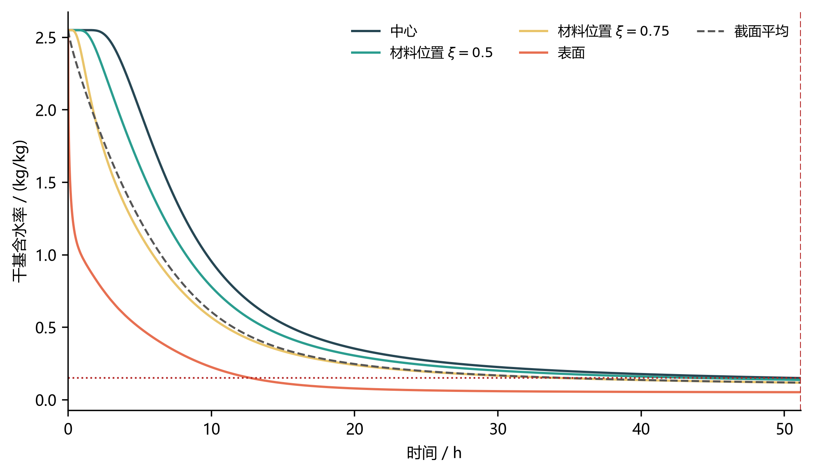

# CUMCM 2026 A｜药材的烘干问题

**2026 年高教社杯全国大学生数学建模竞赛 · A 题 · 省级一等奖**

本仓库整理参赛队的最终提交论文、Python 求解代码及复现说明。
以圆柱形药材为对象，依次研究预热阶段传热传质、变物性干燥、全域水分达标时间和收缩边界反馈。

[阅读论文](paper/paper.pdf) · [复现说明](docs/reproduction.md) · [整理变更](docs/publication-changes.md) · [提交结果](results/submitted/)



## 四问概览

| 问题 | 方法 | 论文报告结果 |
| --- | --- | --- |
| Q1 预热阶段 | Fourier–Fick 方程、Robin 边界、有限体积与 BDF 积分 | 1800 s 中心/表面温度 33.5753/36.7856 °C |
| Q2 变物性干燥 | 热物性与扩散系数随水分、温度变化 | 3 h 中心/表面水分浓度 1.7662/1.0081 kg/kg |
| Q3 全域达标 | 最大水分浓度不高于 0.15 kg/kg | 达标时间约 57.51 h |
| Q4 收缩反馈 | 材料坐标、半径数据拟合与水分驱动的移动边界 | 达标时间约 51.16 h，最终半径约 1.202 cm |

以上数值为论文报告值。2026-10-13 重跑四问后，四张结果表共 677,875 个数值单元格与提交版完全一致；详见复现说明。

## 快速运行

建议 Python 3.13.13，在仓库根目录执行：

```bash
python -m venv .venv
# Windows PowerShell：.venv\Scripts\Activate.ps1
# macOS / Linux：source .venv/bin/activate
python -m pip install -r requirements-tested.txt
python run.py all
```

生成文件位于 `outputs/`，提交时的结果位于 `results/submitted/`。也可运行 `python run.py q1` 等单问命令。
完整网格、步长、积分器及守恒检查使用 `python run.py validate`，需要先完成四问计算。

## 目录

- `paper/`：最终提交论文及随支撑材料提交的 AI 工具使用说明。
- `src/`：四问代码、共用求解器和 Q3/Q4 数值验证脚本。
- `data/`：赛题附件中的输入数据与结果表模板。
- `results/submitted/`：提交时的结果表和图片，供复现对照。
- `docs/`：运行说明、验证记录和逐文件来源哈希。
- `outputs/`：本机运行生成的文件，不纳入 Git。

## 版本与使用说明

论文 PDF 按最终提交文件原样收录。代码仅为独立运行调整路径和目录创建，并新增运行入口；具体变更见 [整理记录](docs/publication-changes.md)。
保留原始 AI 使用说明；本次赛后仓库整理另有 Codex 辅助，不回写竞赛提交声明。

赛题附件来自竞赛提供材料，见 [数据说明](data/README.md)。当前未附 LICENSE，后续授权方式由作者确定。
引用本作品时请注明仓库链接与具体提交版本。
